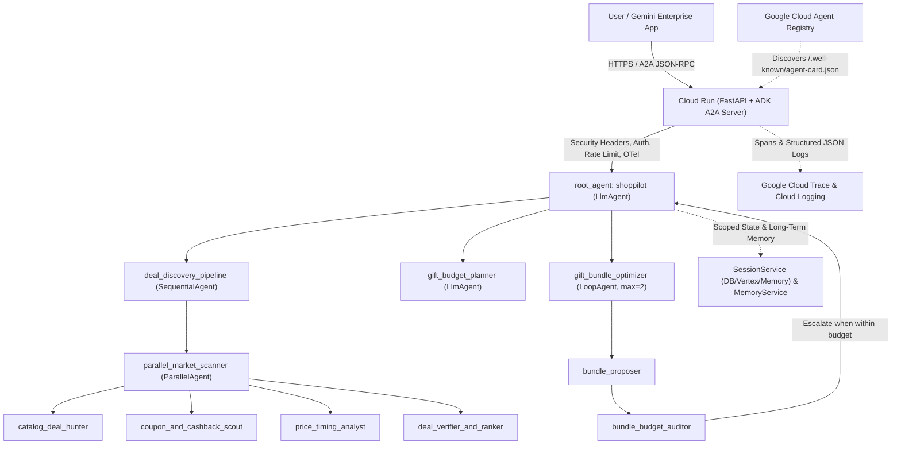

# ShopPilot — Automated Holiday Shopping Assistant

**ShopPilot** is a production-ready, multi-agent holiday shopping assistant built with the **Google Agent Development Kit (ADK)**, exposed via the **Agent-to-Agent (A2A)** protocol on **Google Cloud Run**, and ready for **Google Cloud Agent Registry** registration and **Gemini Enterprise** integration.

It helps shoppers find genuine holiday deals across major retailers, exposes inflated *"fake holiday sales"* using 90-day price history, stacks promo codes + cashback portals + credit card rewards, and manages persistent holiday budgets, watchlists, and multi-recipient gift bundles.

---

## Architecture Overview



---

## Evaluation Criteria Alignment (95-Point Rubric)

| Criterion | Implementation Highlights | Key Files |
| :--- | :--- | :--- |
| **1. Tool & Interface Design** | 10 typed, input-validated ADK tools with uniform `ToolResponse` envelopes, strict allow-lists/bounds, fake-deal detection, coupon stacking math, plus a complete **A2A Agent Card** (`/.well-known/agent-card.json`) with 4 `AgentSkill` definitions and `/a2a` JSON-RPC endpoint. | `shoppilot/schemas.py`, `shoppilot/tools/`, `shoppilot/a2a/card.py`, `app/server.py` |
| **2. Context & Memory** | Multi-tier ADK scoped state (`user:preferences`, `user:holiday_budget`, `user:watchlist`, `user:price_alerts`, `session:last_search_results`), pluggable `SessionService` (InMemory / Cloud SQL `DatabaseSessionService` / `VertexAiSessionService`), `MemoryService` (`InMemoryMemoryService` / `VertexAiMemoryBankService`) with `load_memory` + `after_agent_callback` persistence, and token-efficient dynamic context injection in `before_model_callback`. | `shoppilot/memory/services.py`, `shoppilot/tools/memory_state_tools.py`, `shoppilot/observability/callbacks.py` |
| **3. Orchestration & Logic** | Hierarchical multi-agent graph combining all 4 ADK primitives: `LlmAgent` concierge router, `ParallelAgent` (3 concurrent market/coupon/timing scouts), `SequentialAgent` (fan-out -> `deal_verifier_and_ranker` via `output_key` state passing), and `LoopAgent` (`gift_bundle_optimizer` with `exit_bundle_loop` escalation), plus prompt-injection guardrails. | `shoppilot/agent.py`, `shoppilot/observability/callbacks.py` |
| **4. Observability & Tracing** | OpenTelemetry `TracerProvider` with `CloudTraceSpanExporter` + W3C `traceparent` propagation for distributed A2A traces, FastAPI auto-instrumentation, ADK lifecycle callbacks emitting per-model/per-tool spans, token usage & p95 latency metrics (`/metrics`), Cloud Logging JSON formatter with automatic PII/secret redaction, and an ADK evaluation suite. | `shoppilot/observability/telemetry.py`, `shoppilot/observability/logging_utils.py`, `shoppilot/observability/callbacks.py`, `evals/holiday_shopping.evalset.json` |
| **5. Infrastructure & CI/CD** | Multi-stage non-root `Dockerfile`, declarative `cloudrun/service.yaml` with probes & scaling, `cloudbuild.yaml` and `.github/workflows/ci-cd.yml` (lint, mypy, pytest coverage gate, Docker build, WIF Cloud Run deploy, post-deploy smoke test), plus turnkey scripts for GCP setup, Cloud Run deploy, **Agent Registry**, and **Gemini Enterprise**. | `Dockerfile`, `cloudrun/service.yaml`, `cloudbuild.yaml`, `.github/workflows/ci-cd.yml`, `scripts/`, `deploy/` |

---

## Repository Structure

```text
shoppilot/
├── app/
│   └── server.py                           # Cloud Run FastAPI + ADK A2A server, security & OTel middleware
├── shoppilot/
│   ├── agent.py                            # Multi-agent orchestration (root_agent + Parallel/Sequential/Loop)
│   ├── config.py                           # Pydantic Settings (env-driven, zero hardcoded secrets)
│   ├── schemas.py                          # Strict Pydantic models & ToolResponse envelope
│   ├── catalog_data.py                     # Holiday catalog, 90-day price history, coupons & calendar
│   ├── a2a/card.py                         # A2A AgentCard & AgentSkill definitions
│   ├── memory/services.py                  # SessionService & MemoryService factories
│   ├── observability/
│   │   ├── telemetry.py                    # OpenTelemetry Cloud Trace + in-process metrics
│   │   ├── logging_utils.py                # Cloud Logging JSON formatter + PII redaction
│   │   └── callbacks.py                    # Guardrails, context injection, tracing & memory callbacks
│   └── tools/
│       ├── deal_tools.py                   # search_holiday_deals, compare_product_prices, check_price_history_and_buy_timing
│       ├── coupon_tools.py                 # find_coupons_and_cashback, calculate_stacked_savings
│       └── memory_state_tools.py           # preferences, watchlist, budget, price alerts, exit_bundle_loop
├── cloudrun/service.yaml                   # Declarative Cloud Run Knative manifest
├── deploy/                                 # Agent Registry & Gemini Enterprise JSON templates
├── scripts/                                # GCP setup, Cloud Run deploy, Agent Registry & GE registration
├── evals/holiday_shopping.evalset.json     # ADK evaluation set (trajectory + final response)
├── tests/                                  # Unit & integration tests (tools, callbacks, orchestration, server)
├── Dockerfile                              # Multi-stage non-root container
├── cloudbuild.yaml                         # Google Cloud Build CI/CD pipeline
├── .github/workflows/ci-cd.yml             # GitHub Actions CI/CD pipeline
├── Makefile                                # Developer workflow shortcuts
└── pyproject.toml                          # Packaging, Ruff, Mypy, Pytest config
```

---

## Local Development & Testing

### 1. Setup Environment
```bash
python3 -m venv .venv
source .venv/bin/activate
pip install -e ".[dev]"
cp .env.example .env
# Edit .env with your GOOGLE_CLOUD_PROJECT (or GOOGLE_API_KEY for AI Studio)
```

### 2. Run Linting, Typechecking & Tests
```bash
make lint
make typecheck
make test
```

### 3. Run Locally
- **Production A2A + FastAPI Server** (binds to `127.0.0.1:8080`):
  ```bash
  make run
  # Inspect A2A Agent Card:
  curl http://127.0.0.1:8080/.well-known/agent-card.json
  # Inspect health & observability metrics:
  curl http://127.0.0.1:8080/healthz
  curl http://127.0.0.1:8080/metrics
  ```
- **ADK Interactive Developer UI**:
  ```bash
  make adk-web
  ```
- **ADK Trajectory Evaluation**:
  ```bash
  make eval
  ```

---

## Deploying to Google Cloud Run

### 1. Provision GCP APIs, Artifact Registry & Least-Privilege Service Account
```bash
export GOOGLE_CLOUD_PROJECT="your-gcp-project-id"
export GOOGLE_CLOUD_LOCATION="us-central1"

./scripts/setup_gcp.sh
```

### 2. Build, Deploy & Smoke-Test on Cloud Run
```bash
./scripts/deploy_cloud_run.sh
```
This builds the multi-stage non-root container, deploys to Cloud Run with `--no-allow-unauthenticated`, enables Cloud Trace (`ENABLE_CLOUD_TRACE=true`), updates `PUBLIC_BASE_URL` to the live HTTPS URL, and verifies `/healthz` and `/.well-known/agent-card.json`.

*(Alternatively, deploy via Cloud Build: `gcloud builds submit --config=cloudbuild.yaml .`, or use `adk deploy cloud_run`.)*

---

## Registering in Google Cloud Agent Registry

Once deployed on Cloud Run, register ShopPilot's live A2A Agent Card into **Google Cloud Agent Registry** so enterprise orchestrators and Gemini Enterprise can discover it:

```bash
export GOOGLE_CLOUD_PROJECT="your-gcp-project-id"
export GOOGLE_CLOUD_LOCATION="us-central1"

./scripts/register_agent_registry.sh
```

Verify registration:
```bash
gcloud alpha agent-registry agents list \
  --project="${GOOGLE_CLOUD_PROJECT}" \
  --location="${GOOGLE_CLOUD_LOCATION}" \
  --filter="displayName:ShopPilot"
```

---

## Making ShopPilot Available in a Gemini Enterprise App

1. **Create or locate your Gemini Enterprise App (Discovery Engine)** in Google Cloud Console (*AI Applications / Gemini Enterprise*) and note your `GE_ENGINE_ID` (recommended location: `global`).
2. **Grant Cloud Run Invoker IAM permission** to the Discovery Engine / Gemini Enterprise service agent so it can invoke your authenticated Cloud Run endpoint:
   ```bash
   PROJECT_NUMBER="$(gcloud projects describe "${GOOGLE_CLOUD_PROJECT}" --format='value(projectNumber)')"
   gcloud run services add-iam-policy-binding shoppilot \
     --region="${GOOGLE_CLOUD_LOCATION}" \
     --member="serviceAccount:service-${PROJECT_NUMBER}@gcp-sa-discoveryengine.iam.gserviceaccount.com" \
     --role="roles/run.invoker"
   ```
3. **Register ShopPilot as an A2A Agent on your Gemini Enterprise App**:
   ```bash
   export GE_ENGINE_ID="your-gemini-enterprise-engine-id"
   export GE_LOCATION="global"

   ./scripts/register_gemini_enterprise.sh
   ```
4. Open your **Gemini Enterprise** web app — **ShopPilot Holiday Shopping Assistant** will appear in the agent directory with all 4 skills ready for end-users.

---

## Security & Guardrails Summary
- **No hardcoded secrets**: All credentials and configuration come from environment variables / Secret Manager.
- **Authenticated Cloud Run deployment**: `--no-allow-unauthenticated` by default + Bearer/API-key middleware when `REQUIRE_AUTH=true`.
- **Hardened HTTP headers**: `Content-Security-Policy`, `X-Content-Type-Options: nosniff`, `X-Frame-Options: DENY`, `Permissions-Policy`, `Cache-Control: no-store`, and strict CORS allow-listing (no `*`).
- **Rate limiting**: Per-client sliding-window limiter (`429 Too Many Requests`).
- **Prompt-injection guardrail & PII redaction**: Suspicious prompt-injection inputs are intercepted in `before_model_callback`; emails, card numbers, SSNs, and bearer tokens are scrubbed before hitting logs.
- **Least-privilege container & IAM**: Non-root container user (`shoppilot`) and dedicated GCP Service Account with only Vertex AI, Cloud Trace, Logging, Monitoring, and Secret Manager accessor roles.
